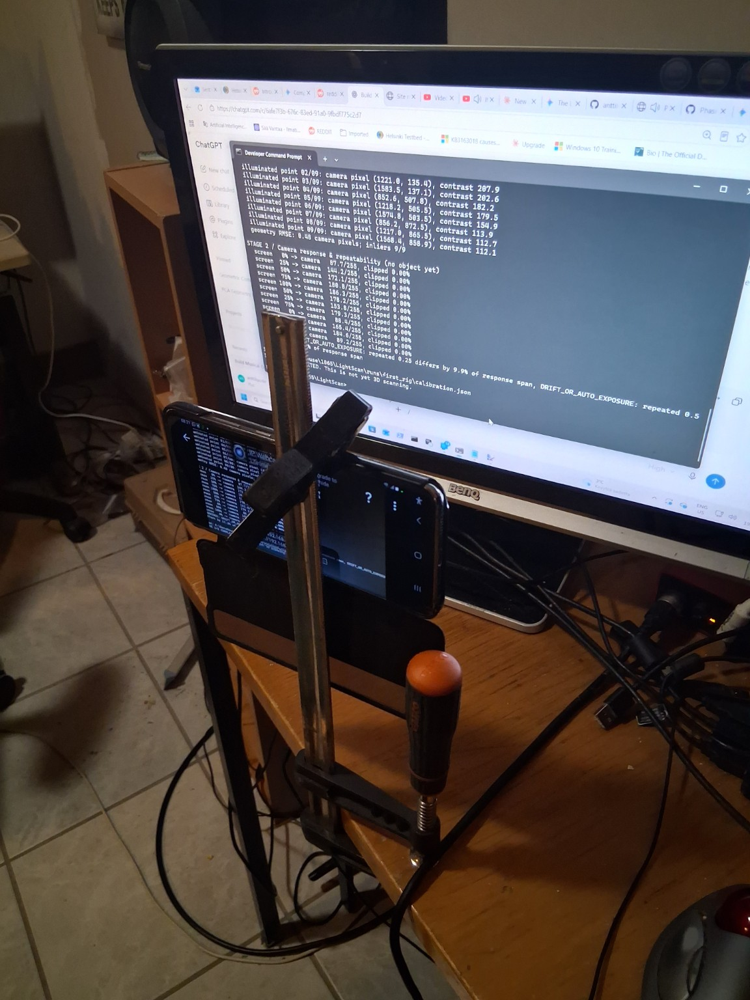

# LightScan — monitor + phone camera inverse-imaging laboratory



**Milestone 1: real hardware calibration, not yet 3D CT.**

This repo is the first physical measurement instrument on the way toward a low-cost optical inverse problem: a PC monitor emits known illumination patterns, a fixed Samsung phone running **IP Webcam** captures their appearance, and LightScan measures geometric mapping and checks photometric repeatability before any attempt to solve for a hidden object.

Built from the research direction of [Moon](https://github.com/anttiluode/Moon) (compact physical forward rendering), [Varjoluotain](https://github.com/anttiluode/Varjoluotain) (occluder-assisted inversion), and [HeadAsResonator](https://github.com/anttiluode/HeadAsResonator) (measured transfer functions). **It does not yet copy Moon's forward shader or run a PyTorch 3D inverse solver.**

## First physical setup

```text
                 Samsung S20 Ultra (IP Webcam)
                            📷
                            │   ~30–45 cm, rigid stand
                            ▼
                      [camera sees]
                  +------------------+
                  |   light patterns |   PC monitor, upright
                  |   15 x 15 cm     |   centered, black background
                  +------------------+
```

- Fix the phone so it cannot move while capturing. Keep the camera aimed near-perpendicular to the monitor. The rectangular active area is specified in **screen pixels**, not automatically centimetres: measure the real displayed size, and adjust `--zone-px`.
- **Initially put nothing between phone and monitor.** Focus on the plane of the future diffuser/object; use manual focus/ISO/shutter/white balance if the Android IP Webcam app supports them. Lock screen brightness, disable automatic monitor brightness/HDR/contrast or dynamic image processing if possible.
- Use a darkened room. Avoid glare and specular reflections. Clean the screen with a dry, screen-safe microfiber cloth; never pour liquids onto the monitor.
- Later, make a **freestanding cardboard spacer/cradle**, holding frosted plastic a few centimetres in front of the display. Never tape wet wax, hot material, sharp objects or heavy objects onto the monitor.
- The phone and computer must be on the same reachable local network. The IP address is local to your LAN; this cloud assistant cannot connect to it.

## Windows quick start

Check from **your PC**, in a browser, that the phone's IP Webcam service works at `http://PHONE_IP:8080/`. In particular try the snapshot URL `http://PHONE_IP:8080/shot.jpg` or the video stream `http://PHONE_IP:8080/video`.

```bat
cd /d D:\anttiluode\LightScan
git pull --ff-only
python3.13 -m pip install -r requirements.txt
python3.13 lightscan.py --url http://PHONE_IP:8080/ --preview --output runs\first_rig
```

The capture defaults to the `/shot.jpg` endpoint because new snapshots usually avoid lagged MJPEG queues. For a camera stream whose snapshot endpoint is unavailable, add `--camera-mode video`.

The `--preview` option shows a small live phone view to help aim and manually focus. **Press Space** in the preview window to begin taking measurements. The preview closes before calibration so that its light cannot contaminate the measurements. On a single-monitor setup, this is particularly useful.

### On-screen guide: no need to see Command Prompt

The full-screen illumination window now includes a **guide across the top**, above the calibrated light square. It displays Stage 1 (screen geometry), Stage 2 (camera brightness) and Stage 3 (blank diffuser / hidden object). Guidance is drawn **outside the measured light square** using a black background and dim text, so it does not replace any of the intended light patterns. The banner stays unchanged during comparable camera captures, avoiding false shadow/geometry signals from changing UI text. Keep the phone fixed and avoid putting objects between it and the screen during Stages 1 and 2.

With `--scan`, you will see two prominent **on-screen pause screens**:

1. **INSERT BLANK DIFFUSER** — fit just the plain frosted sheet to the cradle; click the full-screen LightScan window if necessary, then press **Space** (or Enter) to capture 16 reference light spots.
2. **INSERT HIDDEN SHAPE** — add a black paper shape between the screen and the diffuser **without moving the diffuser or camera**; press **Space** for 16 more measurements.

There is no longer any `input()` or terminal wait during Stage 3. **Esc or Q cancels**, and the final results screen stays visible until you press Space to close. The console still records the detailed log, but no longer needs to be visible. On small monitors, the light zone is limited to leave room for the top guide.

The UI banner is constant in position and outside the active zone, but can still emit a little stray light; treat every new physical set-up as uncalibrated until the repeatability checks pass.

The tool takes 9 sequential light-spot measurements to determine a robust screen-plane homography, then 12 brightness exposures including repeated levels (and checks for dynamic response, clipping and drift). It writes:

- `runs/first_rig/calibration.json`: screen geometry, camera mapping, response samples and warnings
- `01_geometry_overlay.png`: camera view with fitted screen quadrilateral and measured spot positions
- `01_empty_screen.png`: dark-screen reference

**Share the report's `stability` and `geometry_rmse_camera_px` results, plus a screenshot of the geometry overlay.** These tell us whether we should adjust the rig or continue to physics.

If the 9 spots appear stale/late on the camera feed, increase `--settle 1.5`. A low geometry RMSE says the screen plane is mapped; it does **not** mean the phone is focused on the right depth.

### Optional first *real* differential measurement

After successful empty calibration, rerun with `--scan`:

```bat
python3.13 lightscan.py --url http://PHONE_IP:8080/ --scan --output runs\diffuser_001
```

At the first prompt install a **blank translucent diffuser** into the fixed cradle. After 16 probes, add a dark shape behind it (between the monitor and diffuser) **without moving the diffuser or camera**. Another 16 probes produce a shadow difference image and camera-frame residual. This is a real-world *2D* measurement, **not an image recovered through arbitrary opaque objects or a 3D depth estimate**.

Note: if the object goes between monitor and diffuser, screen illumination can be heavily blocked; this is the easier calibration case, but it is already worth measuring. Later we test unseen-pattern prediction and depth discrimination separately.

### Simulate the complete hardware pipeline before using phone

```bat
python3.13 lightscan.py --sim --headless --scan --output runs\sim_001
python3.13 -m unittest discover -s tests -v
```

The simulator generates an angled monitor view, a camera-like tone response and a synthetic shadow, then checks measured geometry and repeatability. The simulation is **not** evidence of reconstructing a real hidden bead or of faithfully modeling multiple scattering.

## Why we don't simply apply `pixel^2.2` to the camera

Most phone streaming apps emit 8-bit JPEG after proprietary exposure, white balance, HDR, gamma and sharpening. Display brightness itself is also nonlinear. `sRGB^2.2` is not a universal calibration. The program therefore records a *camera-display system response curve* and repeated levels; until calibrated by a stronger radiometric reference, pixels are explicitly described as **camera levels**, not radiance or optical density. Passing the repeat test is necessary but **does not prove that automatic exposure is disabled**.

## Physical success gates

1. **Geometry:** spot centres reproducible, ≥7/9 RANSAC inliers, ≤7 px reprojection RMSE; verify overlay visually.
2. **Radiometry:** sufficient dynamic range; monotonic response, no significant clipping or repeated-level drift. Keep exposure/ISO/focus fixed.
3. **Medium measurement:** blank diffuser pattern is repeatable, inserted physical object produces an informative spatial difference.
4. **Inverse milestone (NOT IMPLEMENTED):** fit a model to some light positions and predict held-out ones better than a simple 2D baseline. Only then attempt a sparse 3D reconstruction with physically labelled material parameters.
5. **Hidden-object challenge (NOT IMPLEMENTED):** blind, independently known bead position and depth; repeated samples and no-leak controls.

**Safety:** do not shine high-power lights at eyes or use UV sources; keep liquids, melted wax and pressure away from electronics. The project is an optical experiment, not medical imaging.
